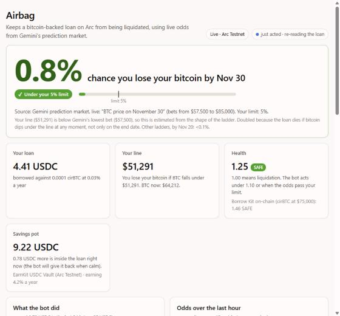
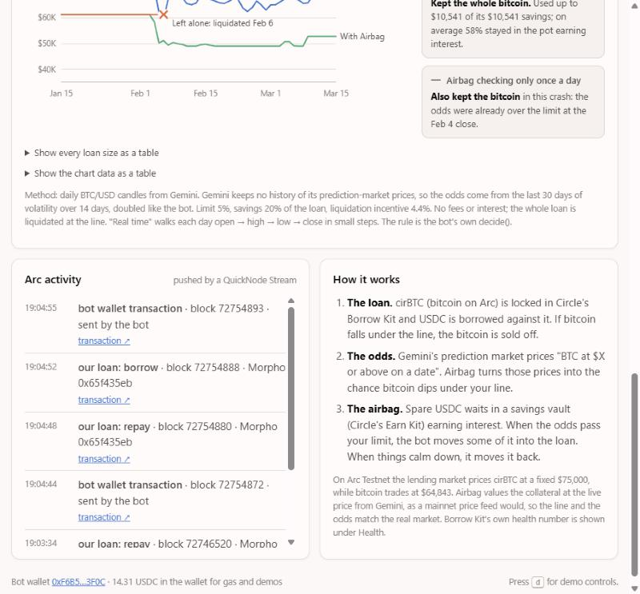
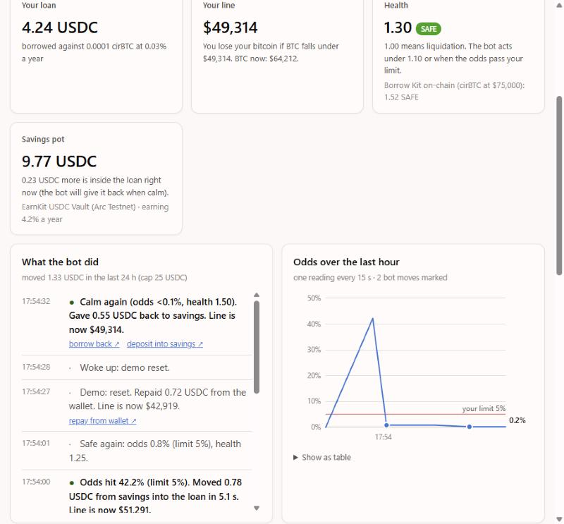

# Airbag

**Every loan app shows a ratio nobody understands. Airbag shows the real odds you lose your bitcoin, from a live market, and fixes the loan by itself.**

Airbag watches a cirBTC-backed USDC loan on [Arc](https://arc.network) (Circle's Borrow Kit). It reads the odds of bitcoin falling under the loan's liquidation line from Gemini's prediction market. When those odds pass your limit, it moves USDC from a savings vault (Circle's Earn Kit) into the loan. When the market calms down, it moves the money back. Nobody presses anything.

**Live on Arc Testnet (Nov 17, 2026):** we pushed a real loan into danger and Airbag saved it with no human input. The push landed at 21:53:55 UTC. The bot read the odds at 42% (limit 5%), withdrew 0.78 USDC from savings and repaid the loan. The repay landed at 21:53:59, and the odds were back to 0.8%. Two transactions, 0.0154 USDC of gas. See [Live proof](#live-proof).

| 1. Pushed to the edge: 42%, over the limit | 2. Four seconds later, saved by Airbag: 0.8% |
|---|---|
|  |  |

---

## 1. How it works

```
                     +------------------+
   Gemini API  ----> |                  | ---->  Arc Testnet (Circle App Kit)
   (odds, BTC price) |    THE BOT       |        - Borrow Kit: read loan, repay, borrow
                     |  src/server.ts   |        - Earn Kit:   deposit, withdraw
   Alarms      ----> |  src/bot.ts      |
   - timer (5 s)     +------------------+
   - Borrow Kit webhook        |
   - QuickNode Stream          v
                         DASHBOARD  (public/index.html)
                         big odds number, the line, savings, log with explorer links
```

The loop (`src/bot.ts`), every time something wakes it up:

1. **Wake up.** A 5-second timer, Borrow Kit's health-band webhook, a QuickNode Stream delivery, or a demo button.
2. **Read.** The loan from Borrow Kit (`getPosition`), savings from Earn Kit (`getPosition`), the Gemini ladders (cached 20 s) and the live BTC price.
3. **Decide.** `decide()` in [`src/brain.mjs`](src/brain.mjs) returns `repay`, `give_back`, `out_of_savings` or `nothing`.
4. **Act.**
   - repay: `kit.earn.withdraw` → `kit.borrow.repay`
   - give back: `kit.borrow.borrow({ loanId })` → `kit.earn.deposit`
5. **Log** what it did and why, with explorer links.

Safety rules in the loop:
- Only one run at a time. A timer alarm during a run is skipped; a webhook/stream alarm re-runs once after.
- After acting it waits 8 s and re-reads the loan before acting again. Borrow Kit reports `PENDING` for a moment after every change, and the bot never decides on `PENDING` data.
- A daily cap on USDC moved (`DAILY_CAP_USDC`), enforced on the server.
- `DRY_RUN=true` decides and logs but sends nothing.
- If Gemini is down, it falls back to the health rule only.

**The rule:** act if `odds > your limit` **or** `health < 1.10`.
- **Repay** down to the safer of two lines: health 1.25, or the highest line whose odds are under your limit.
- **Give back** only when odds are under half your limit **and** health is above 1.40. Never push health under 1.30, nor the odds over half the limit. This band is what stops the bot from flip-flopping (there is a test for it).

## 2. The odds (Gemini)

Endpoints used (public, no key, read only):

| Endpoint | Used for |
|---|---|
| `GET /v1/prediction-markets/events/{ticker}` | the ladder of "BTC at $X or above on <date>" bets |
| `GET /v1/prediction-markets/events?status=active&category=crypto&limit=50&offset=N` | finding the active BTC ladders when the configured ones expire |
| `GET /v1/pubticker/btcusd` | the live BTC price |
| `GET /v2/candles/btcusd/1day` | a year of daily prices for the crash replay |

Default ladders: `BTC2611302200` ("BTC price on November 30", 12 bets, $57,500 to $85,000, about $97k traded) and `BTC2611202200` (Nov 20, 21 bets, $61,000 to $71,000). Pattern: `BTC` + `YYMMDD` + `2200` (they settle at 22:00 UTC).

How a ladder becomes "the chance you lose your bitcoin":

1. **Chance above.** Each bet's chance is the middle of its best bid and best ask. A row of slightly inconsistent thin quotes is tidied so the chance never goes up as the strike rises.
2. **Between bets.** The chance BTC ends below the line is interpolated linearly between the two nearest bets.
3. **Doubled, capped at 100%.** The bet is about the price at 5 PM ET on one day, but a loan dies if the price touches the line at any moment. For a random walk with no drift this is the reflection principle: P(touch) = 2 × P(end below).
4. **Below the lowest bet** (where a healthy loan's line usually sits) there is no quote. Airbag fits a log-normal to the ladder (`z = a + b·ln K` by least squares on bets priced between 2% and 98%), then continues the curve under the lowest bet, anchored to that bet's quote so it is continuous. The dashboard labels these odds **estimated**; inside the ladder they are **quoted**. On Nov 17 the fit gave σ = 0.086 for the 13-day ladder and σ = 0.045 for the 3-day one. That ratio is close to √(3/13), which is what you would expect if the fit is sensible.
5. **Worse of all ladders.** With several ladders, the bot uses the worst odds.

What it looked like on Nov 17 2026 (BTC $64,058, `npm run odds`):

| Health (live price) | Line | Odds the loan dies by Nov 30 |
|---|---|---|
| 1.40 | $45,756 | <0.1% (estimated) |
| 1.25 | $51,246 | 0.8% (estimated) |
| 1.20 | $53,382 | 3.1% (estimated) |
| 1.15 | $55,703 | 10.4% (estimated) |
| 1.10 | $58,235 | 27.9% (quoted) |
| 1.056 | $60,661 | 50.2% (quoted) |

So with a 5% limit the odds trigger fires around health 1.19, before Borrow Kit's own `WARN` band starts (1.20 to 1.10). How early it fires depends on how nervous the market is that day.

## 3. How Arc and Circle's kits are used

All on **Arc Testnet** (chain id `5042002`, RPC `https://rpc.testnet.arc.io`, explorer `https://explorer.testnet.arc.io`), through `@circle-fin/app-kit` 1.22 with the `@circle-fin/adapter-viem-v2` private-key adapter. No Solidity: we only call Circle's kits and existing contracts.

| What | Address / id |
|---|---|
| Borrow Kit market cirBTC → USDC (Morpho, LLTV 0.86) | `0xf8a71f6df9dc7725d1c2fd848e4635d1e9ddca11da4e2dc2f9801005bd2b5d58` |
| Morpho Blue (the lending contract under Borrow Kit) | `0x65f435eb4ff05f1481618694bc1ff7ee4680c0a4` |
| The market's price oracle (returns a fixed 75,000) | `0x917E3d9F366B0561c13155BECdBC8d79E4ED7BA3` |
| Our loan (Borrow Kit loan id) | `e4c53980-53a9-5564-a385-73ba1ac933f9` |
| cirBTC (8 decimals) | `0xf0C4a4CE82A5746AbAAd9425360Ab04fbBA432BF` |
| USDC (ERC-20 view of native USDC, 6 decimals) | `0x3600000000000000000000000000000000000000` |
| Earn Kit savings vault "EarnKit USDC Vault (Arc Testnet)", 4.2% APY | `0xaabbef1d3971c710276ed41ec791bbe14cdb8e88` |
| Bot wallet (testnet only) | `0xF6B5177872Fc12DCBcE76d023e96988fB7Fa3F0C` |

Kit calls in [`src/arc.ts`](src/arc.ts):

| Kit | Calls |
|---|---|
| Borrow Kit | `exploreMarkets`, `getLoans`, `getPosition`, `getMaxBorrow`, `borrow` (open, and borrow more with `loanId`), `repay`, `addCollateral`, `registerWebhook` |
| Earn Kit | `exploreVaults`, `getPosition`, `deposit`, `withdraw` |

Wallet balances are read directly with viem.

**What running it live taught us** (each one is handled in the code):
1. **Use the `/next` adapter.** Borrow Kit needs an atomic batch. An ordinary wallet (EOA) can only do one on Arc through the adapter build at `@circle-fin/adapter-viem-v2/next`, which uses Arc's sender-preserving batcher. The default import fails with `INPUT_UNSUPPORTED_ACTION`.
2. **The local clock matters.** Borrow Kit signs each write with a deadline about 2 minutes out and checks it against the local clock. Our laptop was 157 s fast, so every write failed with "execution deadline has expired". [`src/clock.ts`](src/clock.ts) measures the skew against Arc's latest block at startup and corrects it for the process.
   - A failed opening still registers a loan id. It is completed with `borrow({ loanId })`, which `npm run loan:open` now does.
3. **Borrow Kit's position can be stale.** Right after a repay, `getPosition` said `READY` but still showed the old debt, which could make a bot repay twice. Airbag reads the loan straight from Morpho (`position`, `market` and the oracle's `price`) and savings straight from the vault (ERC-4626 `balanceOf` + `convertToAssets`). The kits' read APIs are the fallback.

Borrow Kit only took as much cirBTC as its borrowing cap needs (0.0000757 of our 0.0001). The script then posts the rest with `addCollateral`.

**Testnet quirk (measured Nov 17).** Arc Testnet's lending market prices cirBTC at a **fixed $75,000** (from Borrow Kit's quotes: health × liquidation price). Real bitcoin was about $64,000 that day. A loan priced at a frozen $75k never gets closer to liquidation when bitcoin moves, and its line would not line up with Gemini's ladder.

So by default (`PRICE_SOURCE=real`) Airbag values the collateral at Gemini's live BTC price, the way a mainnet price feed would. Borrow Kit's own on-chain health is shown next to it on the dashboard. On mainnet the two prices agree and this setting changes nothing.

Borrow Kit lends at most up to health ≈ 1.236 at the $75k price (about 70% LTV). At the live price that is health ≈ 1.06, which is how the demo's "Push it to the edge" button gets a loan into danger.

## 4. Economic design

- **Where the savings come from.** The user's own USDC, parked in an Earn Kit vault (Morpho, 4.2% APY on testnet). It is the loan's emergency fund and earns interest while it waits.
- **When it moves.** Only when the odds pass the user's limit (default 5%) or health drops under 1.10, and only as much as needed to reach the target line.
- **When it comes back.** When odds are under half the limit and health is above 1.40. It is borrowed back out of the same loan and re-deposited.
- **What it costs.**
  - Arc gas is paid in USDC. Measured on our live run: a save (withdraw + repay) cost 0.0154 USDC; a give-back (borrow + deposit) cost 0.0162 USDC.
  - Borrow Kit charges no fee on repay or borrow-more. Fees only apply when a loan is first opened; ours showed `fees: []`.
  - Moving money into the loan gives up the vault yield on that money while it is there.
- **Who holds the keys.** In this demo, the server holds a testnet-only private key in `.env`. A real version would use Circle Wallets, or a small contract that can only repay its owner's own loan.

## 5. Risk assumptions (read this)

- **Thin market.** The odds come from a thin market. The Nov 30 ladder had about $97k traded, the weekly one about $15k, and some quotes barely move all day. That is why the bot also acts on health alone.
- **Rough corrections.** The odds are doubled as a rough "dips under at any time" fix. Below Gemini's lowest bet they are a model estimate (labelled on screen), not a market price.
- **The bot must be online.** If it is down, nothing is protected. The Borrow Kit webhook and the QuickNode Stream wake it faster, but neither replaces it.
- **Testnet price.** The testnet lending market uses a fixed cirBTC price, so the testnet loan cannot actually be liquidated by bitcoin moving. Airbag acts on the live price (section 3).
- **Demo custody.** The server holds the key.
- **It protects the bitcoin, not the dollar value.** If bitcoin keeps falling after a save, being liquidated would have left more cash. Airbag keeps your bitcoin; it does not make money.
- **Savings can run out.** The bot then stops and says so. A next step is selling a small slice of collateral with Swap Kit.
- **No real money.** Not tested with real money.

## 6. QuickNode Stream

[`stream/filter.js`](stream/filter.js), tested in [`test/stream-filter.test.mjs`](test/stream-filter.test.mjs).

- **Network:** Arc Testnet.
- **Dataset:** Block with Receipts.
- **Filter logic.** It keeps only:
  - every Morpho event of our market (`Borrow`, `Repay`, `SupplyCollateral`, `WithdrawCollateral`, `Liquidate`, lender `Supply`/`Withdraw`). These are matched by the **market id** in topic 1, so the filter does not need the Morpho contract address. It also hears about other people's borrows and liquidations in the same market.
  - every transaction to or from the bot wallet.
  - the bot wallet's deposits and withdrawals in the savings vault.

  Everything else returns `null`, so nothing is sent. A liquidation of our own loan is labelled `OUR LOAN LIQUIDATED`.
- **Destination:** a webhook to `https://<server>/api/stream`. The URL holds no secret.
  - The route can't move money, and the server doesn't trust what a delivery says. It fetches every reported transaction from Arc and keeps only those that really touch our market or wallet ([`src/stream-verify.mjs`](src/stream-verify.mjs)).
  - It also computes the label itself, so a fake delivery can't invent a liquidation. Deliveries carrying `WEBHOOK_SECRET` are trusted as-is.
- **Why.** The server stores the matches (shown under "Arc activity" on the dashboard) and wakes the bot, which re-reads the loan at once instead of waiting for the next timer tick.

**Our Stream (live since Nov 17, 2026):**
- `airbag-arc-testnet`: Arc Testnet, Block with Receipts in batches of 5, starting at the latest block.
- The filter above, a webhook to the tunnel.
- In QuickNode's filter editor, block `72746520` (our live save) returns one `our loan: repay` match.

**Verified live:** a 0.1 USDC savings round trip produced four Stream deliveries within seconds. Each one woke the bot:
- `bot wallet transaction` (savings withdraw), block 72754872
- `our loan: repay`, block 72754880
- `our loan: borrow`, block 72754888
- `bot wallet transaction` (savings deposit), block 72754893

The savings vault is a Morpho Vault V2, which emits different events from the ERC-4626 ones the filter looks for. Its moves are still caught, as transactions of the bot wallet.



**Setup:**
1. In QuickNode, open Streams → New stream. Choose Arc / Testnet, start at the latest block, run until paused.
2. Set the dataset to Block with Receipts.
3. Customize the payload: choose JavaScript and paste `stream/filter.js`.
4. Set the destination to Webhook, with the URL `npm run tunnel` prints. Run the connection check, then create the Stream.

Streams bill per block processed, so pause it when nobody is testing. QuickNode pauses a Stream by itself after 3 failed deliveries, for example when the laptop or tunnel is off.

## Running it with a public link

The demo server runs on a laptop, and a free Cloudflare quick tunnel gives it a public https link (no account).

```bash
npm start          # the live bot + dashboard on http://localhost:3000
npm run tunnel     # in a second terminal
```

`npm run tunnel` does three things:
- starts `cloudflared` (put `cloudflared-windows-amd64.exe` from [Cloudflare's releases](https://github.com/cloudflare/cloudflared/releases) at `tools/cloudflared.exe`, or have `cloudflared` on PATH);
- waits until the public link answers, then registers it as the loan's Borrow Kit webhook;
- prints the URL to use as the QuickNode Stream destination.

The link changes on every restart: re-run `npm run tunnel` and update the Stream's destination. Everything stops when the laptop sleeps.

POST routes reached through the tunnel always need `WEBHOOK_SECRET`. The localhost shortcut never applies to proxied requests.

Only ever run one live bot per wallet. Two bots would both repay.

## 7. The crash replay

[`replay/replay.mjs`](replay/replay.mjs) runs the bot's own `decide()` over a year of daily BTC prices from Gemini ([`replay/btc-daily.csv`](replay/btc-daily.csv), Nov 18 2025 to Nov 16 2026). Results are in [`replay/results.json`](replay/results.json). Re-run with `npm run replay`.

**Setup.** A loan is opened on Dec 16, 2025: 1 BTC at $87,842, borrowing 60% ($52,705), so the line is $61,285. On Feb 5 and 6, 2026 bitcoin fell from about $73,000 to a low of $60,000.

| Borrowed | Line | Left alone | Airbag, once a day | Airbag, real time | Most savings in use (real time) | Avg. left in the pot (real time) |
|---|---|---|---|---|---|---|
| 50% | $51,071 | kept 1 BTC | kept 1 BTC | kept 1 BTC | $4,587 of $8,784 | 93% |
| 55% | $56,178 | kept 1 BTC | kept 1 BTC | kept 1 BTC | $8,980 of $9,663 | 77% |
| **60%** | **$61,285** | **liquidated Feb 6, 0.10 BTC left** | **kept 1 BTC** | **kept 1 BTC** | **$10,541 of $10,541** | **58%** |
| 65% | $66,392 | liquidated Feb 5, 0.10 BTC left | kept 1 BTC | kept 1 BTC | $11,419 of $11,419 | 43% |
| 70% | $71,499 | liquidated Feb 5, 0.10 BTC left | kept 1 BTC | kept 1 BTC | $12,298 of $12,298 | 26% |

**What it says.**
- Left alone, the 60% loan is liquidated on Feb 6 and keeps 0.10 BTC.
- With a savings pot worth 20% of the loan, Airbag kept the whole bitcoin at 60%, 65% and 70%.
- At 60%, all of the savings were in use at the worst point. On average 58% stayed in the pot earning interest.
- Loans at 55% and under survived the year with no help.

**What it does not say.** In this crash, an Airbag that checked only once a day did just as well as one reacting in real time: the odds were already over the limit at the Feb 4 close, a day before the big drop. The speed of reacting would matter for a one-day crash from a calm close, which this year did not contain. We do not claim more than that.

**Method and limits.**
- **Odds.** Gemini keeps no history of its prediction-market prices, so past volatility stands in for the odds: P(dies within 14 days) = 2 × Φ(ln(line / price) / (σ √14)), with σ from the previous 30 daily returns.
- **Real time vs once a day.** "Real time" walks each day open → high → low → close in 144 small steps. That is the best case; real life is between it and once a day.
- **Not modelled.** Daily prices only. No fees, interest or vault yield. When the line is touched, the whole loan is liquidated with Morpho's 4.4% incentive.
- **Fixed inputs.** Limit 5%, savings 20% of the loan.
- These numbers replace the rough first draft in our planning notes. Some of the draft's claims did not survive the re-run with the real rule.

## 8. What existed before, and what is new

- Tools that auto-protect loans already exist on Ethereum. **DeFi Saver** is the big one, including repaying from savings.
- Hackathon projects have shown liquidation odds from a formula (PredictLiquidate), used prediction-market odds to set swap fees (Piro), and had agents price one loan's risk in their own mini market (Consilium).
- **New here:**
  - Using a real-money prediction market's odds as the trigger for an ordinary crypto loan.
  - Doing it for Arc's bitcoin loans, on Circle's new Borrow and Earn kits.

  It is a new combination, not a new invention.

## 9. Credits

- Written from Circle's Arc docs and App Kit quickstarts. No code was copied from Circle's sample apps (`arc-usdc-borrowing`, `arc-defi-lend-borrow`).
- The "brain" started from our own plan's version. Its original test is kept unchanged in [`src/brain.test.mjs`](src/brain.test.mjs).
- AI tools: built with Claude Code (Anthropic) as a pair programmer.

## 10. Run it

Needs Node 22+.

```bash
npm install
npm test                      # the brain, the odds model, the demo cycle, the QuickNode filter, the public-demo gate
npm run sim                   # dashboard at http://localhost:3000 with a simulated Arc loan and live Gemini odds
```

Live on Arc Testnet:

```bash
npm run wallet:new            # makes .env with a fresh testnet-only wallet (key stays in .env)
#   fund the printed address at https://faucet.circle.com (Arc Testnet): cirBTC + USDC
npm run balances              # check it arrived
npm run explore               # list Borrow Kit markets and Earn Kit vaults
npm run loan:open             # M1: open the loan (health 1.40 at the live price; pass another, e.g. -- 1.6)
npm run savings:deposit -- 5  # put 5 USDC in the savings pot
npm run roundtrip             # M2: withdraw -> repay -> borrow -> deposit, no human input
npm start                     # the bot + dashboard
```

Other commands:

| Command | What it does |
|---|---|
| `npm run odds` | Print live odds for a range of health levels. |
| `npm run loan:show` | Print the loan, savings and wallet. |
| `npm run preview` | Read-only max-borrow and oracle-price quote. |
| `npm run webhook:register` | Ask Borrow Kit to call `PUBLIC_URL/api/borrow-webhook` on band changes. |
| `npm run replay` | Re-fetch prices and re-run the crash replay. |

Server endpoints:

| Route | What it does |
|---|---|
| `GET /` | dashboard |
| `GET /api/status` | JSON: loan, odds, savings, limit, log, odds samples |
| `GET /api/replay` | crash replay results |
| `POST /api/borrow-webhook?key=` | Borrow Kit band change, wakes the bot |
| `POST /api/stream?key=` | QuickNode Stream delivery, wakes the bot |
| `POST /api/demo/push`, `/reset`, `/pause`, `/limit` | demo controls (header `x-airbag-key`) |

POST routes need `WEBHOOK_SECRET` (header `x-airbag-key` or `?key=`). With no secret set, they only accept requests from localhost.

**Demo controls.** Press `d` on the dashboard and enter `WEBHOOK_SECRET`.
- **Push it to the edge** borrows up to Borrow Kit's maximum. The USDC stays in the wallet, as if spent.
- **Reset** repays from the wallet back to health 1.5. The bot then gives the savings back by itself.

All settings are in [`.env.example`](.env.example).

**Public demo (anyone can press the buttons).** `PUBLIC_DEMO=true npm run sim` shows a *Try the demo* button and lets visitors push the simulated loan to the edge without a key (Pause stays key-only, one shared rate limit). It is ignored in live mode. Hosting it: [`docs/HOSTING.md`](docs/HOSTING.md).

**AirbagGuard** (`contracts/`): a contract that lets the bot's key move the owner's savings into the owner's own loan and back, and nothing else, with a daily cap and a health floor on-chain. See [`contracts/README.md`](contracts/README.md).

Working on the code (or pointing an AI agent at it)? Read [`AGENTS.md`](AGENTS.md) first. The submission draft and demo playbook are in [`docs/`](docs).

## Live proof

Every step below ran on Arc Testnet on Nov 17, 2026, with the bot wallet `0xF6B5…3F0C`. Testnet tokens only.

| Step | What happened | Transactions |
|---|---|---|
| Open the loan (M1) | Borrowed 3.95 USDC against 0.0001 cirBTC, no fees | [borrow](https://explorer.testnet.arc.io/tx/0xee2cb114b06c6be823eea50b317067d2719f9aaf471e1f0cdd8fdc73737ce2cf), [add collateral](https://explorer.testnet.arc.io/tx/0x702f205a0cd758da7af514c1e98db77afca0b28a62a51bac314bf27c3516afd8) |
| Fill the savings pot | 10 USDC into the Earn Kit vault | [deposit](https://explorer.testnet.arc.io/tx/0xdd31d7d30c22d2c8511011406fb7c39f542e9d95df78f9e50de6a6d71cff0368) |
| Savings round trip (M2), no human input | withdraw → repay (3.6 s), borrow → deposit (3.0 s); debt 3.951 → 3.701 → 3.951 | [withdraw](https://explorer.testnet.arc.io/tx/0x2f670763782e66c960f8982cc9d1ee44fcfd737acef60ec4e79a2512d46117f1), [repay](https://explorer.testnet.arc.io/tx/0x3b4c6038c58fdf041a6b09fe3d803711a46b3449bd296eeca99a64aad8f61e9d), [borrow](https://explorer.testnet.arc.io/tx/0x0bfe9cec5b544ca35a4037afa800d4a014be09f7a2b3a9522f2c2c29c8ebb861), [deposit](https://explorer.testnet.arc.io/tx/0x8bf30960d7cdb7f892cb24aaeb7552f78bd6572c5e2a75728ef9c9482ac66424) |
| "Push it to the edge" | Borrowed 1.24 USDC more: health 1.40 → 1.06, odds <0.1% → 42% | [borrow more](https://explorer.testnet.arc.io/tx/0xb82f1377894d3fdab3882e34057ab8465c7fad8323360baae170823458eef69e) (21:53:55 UTC) |
| **The save, by the bot alone** | Moved 0.78 USDC from savings into the loan: health 1.25, line $60,361 → $51,291, odds 0.8% | [withdraw](https://explorer.testnet.arc.io/tx/0xcdbb3219824b862d5fdf35834e89f00f4d5b8a61f04e7d7af6f3240165d01d41) (21:53:57), [repay](https://explorer.testnet.arc.io/tx/0x1b566cce68a7247928a296dba45b6b32ef78e210ba5ebeff863ebabe885c37dc) (21:53:59) |
| "Reset" | Repaid 0.72 USDC from the wallet: health 1.50 | [repay](https://explorer.testnet.arc.io/tx/0xe50f280f378add056d40ff1b88f27bfce7b0386fb0f560c395bb63d4e01c9d60) |
| **The give-back, by the bot alone** | Calm again, so it borrowed 0.55 USDC back into savings, stopping at health 1.30. Then it sat still. | [borrow](https://explorer.testnet.arc.io/tx/0x42dae1b0f36370e73b4021c959930f34f3a604006d4f01d1ebfa77a7b753e9d7), [deposit](https://explorer.testnet.arc.io/tx/0xab4900f8da65f7973a67c0d3359a91eb31ea92dbce035a3cbc2d6a97ea4782f6) |



## What is verified, and what is not

| | Status |
|---|---|
| Brain + odds model (19 automated checks, on real Gemini ladders from Nov 17) | ✅ passing |
| Live Gemini ladders, field names, discovery, BTC price | ✅ read live |
| Opening a loan with Borrow Kit on Arc Testnet (M1) | ✅ live, links above |
| Savings round trip with no human input (M2) | ✅ live |
| Live save and give-back by the bot, on the dashboard | ✅ live: danger to safe in 4 s on-chain |
| Crash replay with the real rule | ✅ numbers above |
| Public link (Cloudflare quick tunnel) with key-protected POST routes | ✅ live; requests without the key, or faking localhost, get 401 |
| Borrow Kit webhook | ✅ registered for our loan. Circle's Borrow Service called it through the tunnel and woke the bot (log: "Woke up: Borrow Kit webhook"). |
| QuickNode Stream deliveries | ✅ The `airbag-arc-testnet` Stream delivered our live round trip (4 transactions, blocks 72754872–72754893); each delivery was verified on-chain and woke the bot. |
| Server that stays on without a laptop | ⏳ The simulator is ready to host on Render (`render.yaml`, `docs/HOSTING.md`), with demo buttons anyone can press. Tested locally; not deployed yet. The live bot still runs on a laptop with a tunnel. |
| AirbagGuard contract (the bot key can only move the owner's savings into the owner's own loan and back) | ⏳ 16 Foundry tests pass (incl. fuzz), and the deploy + try scripts ran on a local chain. Not yet run on Arc Testnet. See [`contracts/README.md`](contracts/README.md). |
