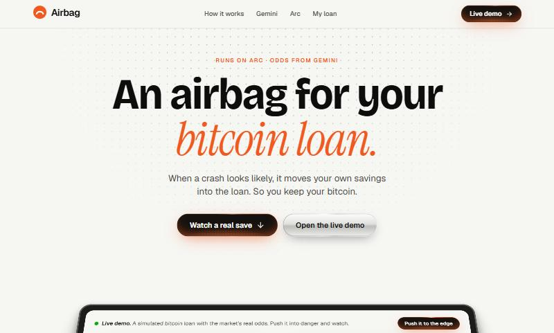
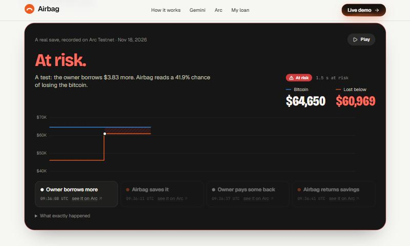
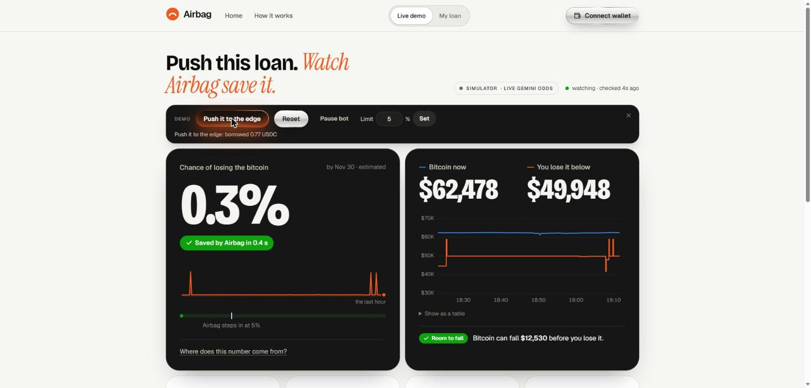
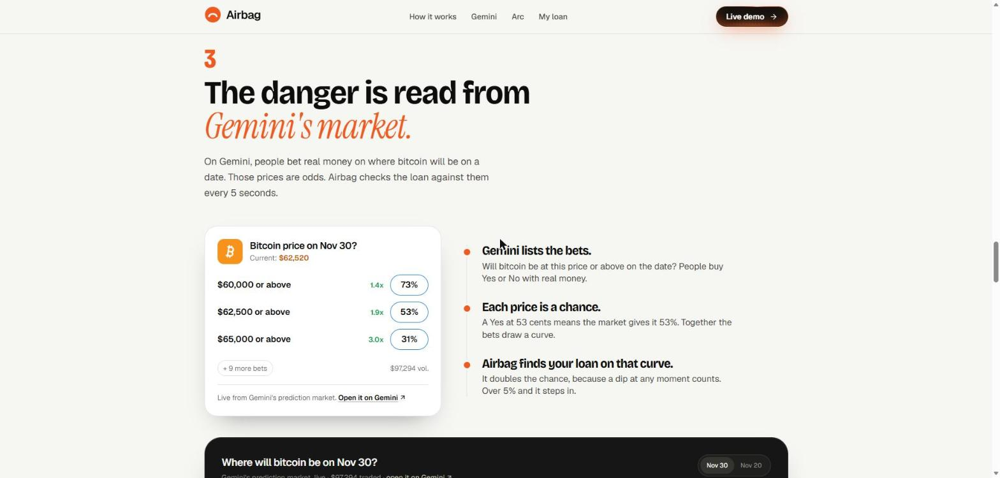
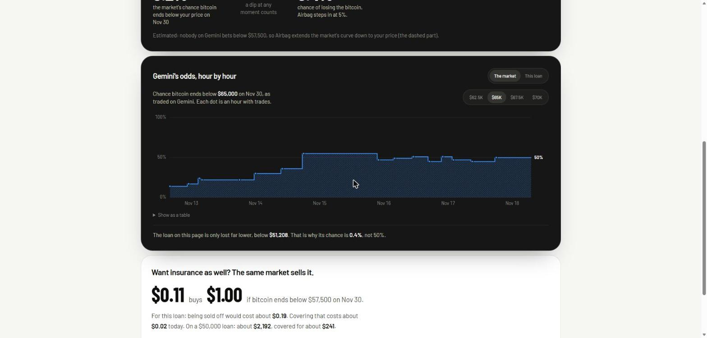
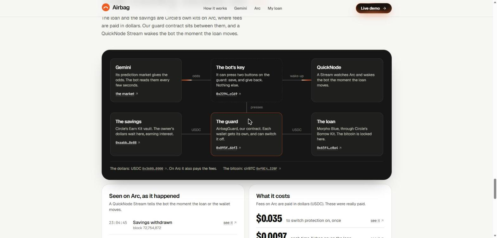
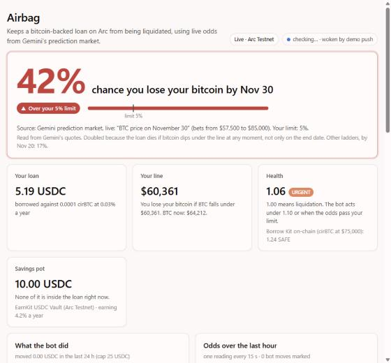

# Airbag

**Every loan app shows a ratio nobody understands. Airbag shows the real odds you lose your bitcoin, from a live market, and fixes the loan by itself.**

Airbag watches a cirBTC-backed USDC loan on [Arc](https://arc.network) (Circle's Borrow Kit). It reads the odds of bitcoin falling under the loan's liquidation line from Gemini's prediction market. When those odds pass your limit, it moves USDC from a savings vault (Circle's Earn Kit) into the loan. When the market calms down, it moves the money back. Nobody presses anything.

**Try it:** [airbagged.me](https://airbagged.me) is the live bot: a real cirBTC loan on Arc Testnet that Airbag is guarding right now. The first screen shows its live number. *Watch a real save* replays a save from its recorded transactions. *Live demo* shows how the number is being made this second, from Gemini's live feed, and where the money is on Arc. *My loan* lets any wallet open a loan and turn protection on. Nothing on it is simulated. The first visit after a quiet spell takes about a minute to load.

**Live on Arc Testnet (Nov 17, 2026):** we pushed a real loan into danger and Airbag saved it with no human input. The push landed at 21:53:55 UTC. The bot read the odds at 42% (limit 5%), withdrew 0.78 USDC from savings and repaid the loan. The repay landed at 21:53:59, and the odds were back to 0.8%. Two transactions, 0.0154 USDC of gas. See [Live proof](#live-proof).

| The real loan, live | A real loan pushed to the edge | The same loan, saved 3 seconds later |
|---|---|---|
|  |  |  |

| Gemini's bets, and how they become the number | The market's own odds, hour by hour | How the money moves on Arc |
|---|---|---|
|  |  |  |

All six show real things: the loan the hosted bot guards on Arc Testnet, Gemini's live market, and the page's replay of the save of Nov 18, 2026, drawn from its recorded transactions. The page as it looked during the first live saves is under [Live proof](#live-proof).

---

## 1. How it works

```
                     +------------------+
   Gemini API  ----> |                  | ---->  Arc Testnet (Circle App Kit)
   (odds, BTC price) |    THE BOT       |        - Borrow Kit: read loan, repay, borrow
                     |  src/server.ts   |        - Earn Kit:   deposit, withdraw
   Alarms      ----> |  src/bot.ts      |
   - timer (5 s)     +------------------+
   - Gemini's live feed        |
   - Borrow Kit webhook        v
   - QuickNode Stream    THE PAGE  (web/, built into public/)
                         big odds number, the line, savings, log with explorer links
```

The loop (`src/bot.ts`), every time something wakes it up:

1. **Wake up.** A 5-second timer, a price move on Gemini's live feed, Borrow Kit's health-band webhook, a QuickNode Stream delivery, or a demo button.
2. **Read.** The loan from Borrow Kit (`getPosition`), savings from Earn Kit (`getPosition`), the Gemini ladders (kept for 20 s, and read again at once when the live feed says a price moved) and the live BTC price.
3. **Decide.** `decide()` in [`src/brain.mjs`](src/brain.mjs) returns `repay`, `give_back`, `out_of_savings` or `nothing`.
4. **Act.**
   - repay: `kit.earn.withdraw` → `kit.borrow.repay`
   - give back: `kit.borrow.borrow({ loanId })` → `kit.earn.deposit`
5. **Log** what it did and why, with explorer links.

Safety rules in the loop:
- Only one run at a time. A timer alarm during a run is skipped; a webhook/stream alarm re-runs once after.
- After acting it waits 8 s and re-reads the loan before acting again. Borrow Kit reports `PENDING` for a moment after every change, and the bot never decides on `PENDING` data.
- A daily cap on USDC moved (`DAILY_CAP_USDC`), enforced on the server.
- `DRY_RUN=true` decides and logs but sends nothing.
- If Gemini is down, it falls back to the health rule only.

**The rule:** act if `odds > your limit` **or** `health < 1.10`.
- **Repay** down to the safer of two lines: health 1.25, or the highest line whose odds are under your limit.
- **Give back** only when odds are under half your limit **and** health is above 1.40. Never push health under 1.30, nor the odds over half the limit. This band is what stops the bot from flip-flopping (there is a test for it).

## 2. The odds (Gemini)

Endpoints used (public, no key, read only):

| Endpoint | Used for |
|---|---|
| `GET /v1/prediction-markets/events/{ticker}` | the ladder of "BTC at $X or above on <date>" bets |
| `GET /v1/prediction-markets/events?status=active&category=crypto&limit=50&offset=N` | finding the active BTC ladders when the configured ones expire |
| `wss://ws.gemini.com`, streams `<bet>@bookTicker` and `<bet>@trade` | each bet's best bid and ask the moment they change: it wakes the bot, and the page shows the market moving |
| `GET /v2/candles/<bet>/1hr` | each bet's own hourly history, for the market-over-time chart |
| `GET /v1/pubticker/btcusd` | the live BTC price |
| `GET /v2/candles/btcusd/1day` | a year of daily prices for the crash replay |

Default ladders: `BTC2611302200` ("BTC price on November 30", 12 bets, $57,500 to $85,000, about $97k traded) and `BTC2611202200` (Nov 20, 21 bets, $61,000 to $71,000). Pattern: `BTC` + `YYMMDD` + `2200` (they settle at 22:00 UTC).

How a ladder becomes "the chance you lose your bitcoin":

1. **Chance above.** Each bet's chance is the middle of its best bid and best ask. A row of slightly inconsistent thin quotes is tidied so the chance never goes up as the strike rises.
2. **Between bets.** The chance BTC ends below the line is interpolated linearly between the two nearest bets.
3. **Doubled, capped at 100%.** The bet is about the price at 5 PM ET on one day, but a loan dies if the price touches the line at any moment. For a random walk with no drift this is the reflection principle: P(touch) = 2 × P(end below).
4. **Below the lowest bet** (where a healthy loan's line usually sits) there is no quote. Airbag fits a log-normal to the ladder (`z = a + b·ln K` by least squares on bets priced between 2% and 98%), then continues the curve under the lowest bet, anchored to that bet's quote so it is continuous. The dashboard labels these odds **estimated**; inside the ladder they are **quoted**. On Nov 17 the fit gave σ = 0.086 for the 13-day ladder and σ = 0.045 for the 3-day one. That ratio is close to √(3/13), which is what you would expect if the fit is sensible.
5. **Worse of all ladders.** With several ladders, the bot uses the worst odds.

What it looked like on Nov 17 2026 (BTC $64,058, `npm run odds`):

| Health (live price) | Line | Odds the loan dies by Nov 30 |
|---|---|---|
| 1.40 | $45,756 | <0.1% (estimated) |
| 1.25 | $51,246 | 0.8% (estimated) |
| 1.20 | $53,382 | 3.1% (estimated) |
| 1.15 | $55,703 | 10.4% (estimated) |
| 1.10 | $58,235 | 27.9% (quoted) |
| 1.056 | $60,661 | 50.2% (quoted) |

So with a 5% limit the odds trigger fires around health 1.19, before Borrow Kit's own `WARN` band starts (1.20 to 1.10). How early it fires depends on how nervous the market is that day.

### The live feed

Gemini pushes every change of a bet's best bid and ask over a public WebSocket (no key). Airbag uses it twice.

- **It wakes the bot** ([`src/gemini-feed.ts`](src/gemini-feed.ts)). The server listens to every bet of the ladders it reads. When a bet's price moves, it throws away the ladders it was keeping and wakes the bot, which reads the prices again over REST and decides as always. The feed only says *when* to look. What the bot decides on has not changed.
  - A move is acted on 1.5 s after it is heard, so a quote that flickers and comes back is not chased, and at most once every 4 s.
  - Each such check restarts the bot's own 5 s timer, so a busy market does not make it read the chain more often.
  - If the socket drops, the bot goes on reading every 20 s. `GEMINI_FEED=false` turns it off.
- **The page shows it** ([`web/src/lib/gemini-feed.ts`](web/src/lib/gemini-feed.ts)). Under each loan, *How this number is made, right now* shows the two bets the loan's price sits between with their live bid and ask, the chance bitcoin ends below that price, and that chance doubled against the limit. The page works these out itself from the feed with the bot's own functions ([`src/brain.mjs`](src/brain.mjs)) and prints the bot's own last check next to them. The card with Gemini's bets and the hedge ticket's price tick from the same feed.

What we measured on Nov 19, 2026 ([`test/gemini-live.test.mjs`](test/gemini-live.test.mjs) runs on the recording):
- One `SUBSCRIBE` message asked for all 33 bets of both ladders (66 streams). Every bet answered at once with its current prices.
- The feed's bid and ask were the same numbers as REST's `bestBid` and `bestAsk` for all 33 bets. So a ladder built from the feed is the ladder the bot reads.
- A bet nobody bids on sends an empty text, not a zero.
- The market is quoted far more often than it trades: in 25 minutes both ladders sent 12,606 price updates and not one trade.
- In the simulator, 11 of the bot's 12 checks in 45 s were woken by the feed.
- On the hosted bot (Nov 19, 2026, 02:12 UTC, the first minute after it went live there): the feed sent 368 updates for 33 bets, 202 of them price moves, and the bot checked every 4 s, "woken by Gemini's live feed".

### What Airbag does with Gemini's prediction markets

| The bounty asks for | What is here |
|---|---|
| Analytics and visualizations that track how market odds move over time | The market's own odds hour by hour for each bet (Gemini's candles), the whole ladder as a curve with the loan's line on it, and the loan's own odds over the last hour. All on the landing page's Gemini part. |
| Trading tools, bots or agents that act on prediction market data | The bot. Gemini's live feed wakes it, it reads the ladders, and when the odds pass the limit it moves testnet money on Arc with no human. And the hedge ticket below. |
| Prediction market data brought into other apps (onchain) | Gemini's odds are the trigger for transactions on Arc. Every save under [Live proof](#live-proof) was caused by them, and the bot's log line records the odds it acted on. |
| Helping people discover and understand markets | The landing page explains the market in three steps from its live prices and links to it on gemini.com. *How this number is made, right now* shows a bet's price turning into one plain number. |

### The hedge ticket

The same market sells protection: a "No" on "bitcoin at $X or above" pays 1 dollar if bitcoin ends below $X. The page turns a loan into the order that covers its sell-off penalty (Morpho takes 4.4% at this market's 86% limit):
- which bet: the lowest one at or above the loan's line;
- how many contracts, the live price of one, what the order costs and what it pays;
- a link to that bet on gemini.com, and the same order in the shape of Gemini's `POST /v1/prediction-markets/order`.

It is a quote. **Airbag sends no order.** Gemini's prediction markets are real money and this project is testnet only. The order's fields are written from Gemini's API reference and were never sent. The page also says what the hedge leaves out: it pays on the end date only, so a dip that takes the loan and then recovers pays nothing. That gap is what Airbag itself covers.

Gemini's sandbox (`api.sandbox.gemini.com`) lists the same prediction markets with its own, nearly empty, order book (read on Nov 19, 2026). Placing a test order there needs a sandbox account and key. We have not tried it.

## 3. How Arc and Circle's kits are used

All on **Arc Testnet** (chain id `5042002`, RPC `https://rpc.testnet.arc.io`, explorer `https://explorer.testnet.arc.io`), through `@circle-fin/app-kit` 1.22 with the `@circle-fin/adapter-viem-v2` private-key adapter. The bot needs no Solidity: it only calls Circle's kits and existing contracts. `AirbagGuard` (`contracts/`) is the one contract we deployed ourselves.

| What | Address / id |
|---|---|
| Borrow Kit market cirBTC → USDC (Morpho, LLTV 0.86) | `0xf8a71f6df9dc7725d1c2fd848e4635d1e9ddca11da4e2dc2f9801005bd2b5d58` |
| Morpho Blue (the lending contract under Borrow Kit) | `0x65f435eb4ff05f1481618694bc1ff7ee4680c0a4` |
| The market's price oracle (returns a fixed 75,000) | `0x917E3d9F366B0561c13155BECdBC8d79E4ED7BA3` |
| Our loan (Borrow Kit loan id) | `e4c53980-53a9-5564-a385-73ba1ac933f9` |
| cirBTC (8 decimals) | `0xf0C4a4CE82A5746AbAAd9425360Ab04fbBA432BF` |
| USDC (ERC-20 view of native USDC, 6 decimals) | `0x3600000000000000000000000000000000000000` |
| Earn Kit savings vault "EarnKit USDC Vault (Arc Testnet)", 4.2% APY | `0xaabbef1d3971c710276ed41ec791bbe14cdb8e88` |
| Bot wallet (testnet only) | `0xF6B5177872Fc12DCBcE76d023e96988fB7Fa3F0C` |
| AirbagGuard (our contract, deployed Nov 18, 2026 for a second test loan) | `0x895fa892dc4ff752ec9114760201f4751c106bf3` |

Kit calls in [`src/arc.ts`](src/arc.ts):

| Kit | Calls |
|---|---|
| Borrow Kit | `exploreMarkets`, `getLoans`, `getPosition`, `getMaxBorrow`, `borrow` (open, and borrow more with `loanId`), `repay`, `addCollateral`, `registerWebhook` |
| Earn Kit | `exploreVaults`, `getPosition`, `deposit`, `withdraw` |

Wallet balances are read directly with viem.

**What running it live taught us** (each one is handled in the code):
1. **Use the `/next` adapter.** Borrow Kit needs an atomic batch. An ordinary wallet (EOA) can only do one on Arc through the adapter build at `@circle-fin/adapter-viem-v2/next`, which uses Arc's sender-preserving batcher. The default import fails with `INPUT_UNSUPPORTED_ACTION`.
2. **The local clock matters.** Borrow Kit signs each write with a deadline about 2 minutes out and checks it against the local clock. Our laptop was 157 s fast, so every write failed with "execution deadline has expired". [`src/clock.ts`](src/clock.ts) measures the skew against Arc's latest block at startup and corrects it for the process.
   - A failed opening still registers a loan id. It is completed with `borrow({ loanId })`, which `npm run loan:open` now does.
3. **Borrow Kit's position can be stale.** Right after a repay, `getPosition` said `READY` but still showed the old debt, which could make a bot repay twice. Airbag reads the loan straight from Morpho (`position`, `market` and the oracle's `price`) and savings straight from the vault (ERC-4626 `balanceOf` + `convertToAssets`). The kits' read APIs are the fallback.

Borrow Kit only took as much cirBTC as its borrowing cap needs (0.0000757 of our 0.0001). The script then posts the rest with `addCollateral`.

**Testnet quirk (measured Nov 17).** Arc Testnet's lending market prices cirBTC at a **fixed $75,000** (from Borrow Kit's quotes: health × liquidation price). Real bitcoin was about $64,000 that day. A loan priced at a frozen $75k never gets closer to liquidation when bitcoin moves, and its line would not line up with Gemini's ladder.

So by default (`PRICE_SOURCE=real`) Airbag values the collateral at Gemini's live BTC price, the way a mainnet price feed would. Borrow Kit's own on-chain health is shown next to it on the dashboard. On mainnet the two prices agree and this setting changes nothing.

Borrow Kit lends at most up to health ≈ 1.236 at the $75k price (about 70% LTV). At the live price that is health ≈ 1.06, which is how the demo's "Push it to the edge" button gets a loan into danger.

## 4. Economic design

- **Where the savings come from.** The user's own USDC, parked in an Earn Kit vault (Morpho, 4.2% APY on testnet). It is the loan's emergency fund and earns interest while it waits.
- **When it moves.** Only when the odds pass the user's limit (default 5%) or health drops under 1.10, and only as much as needed to reach the target line.
- **When it comes back.** When odds are under half the limit and health is above 1.40. It is borrowed back out of the same loan and re-deposited.
- **What it costs.**
  - Arc gas is paid in USDC. Measured on our live run: a save (withdraw + repay) cost 0.0154 USDC; a give-back (borrow + deposit) cost 0.0162 USDC.
  - Borrow Kit charges no fee on repay or borrow-more. Fees only apply when a loan is first opened; ours showed `fees: []`.
  - Moving money into the loan gives up the vault yield on that money while it is there.
- **Who holds the keys.** By default the server holds the wallet's testnet-only private key in `.env`. With `USE_GUARD=true` it holds only a separate bot key instead. Through the `AirbagGuard` contract that key can move the owner's savings into the owner's own loan and back, and nothing else, so the server no longer needs the wallet's key (see AirbagGuard under "Run it").

## 5. Risk assumptions (read this)

- **Thin market.** The odds come from a thin market. The Nov 30 ladder had about $97k traded, the weekly one about $15k, and some quotes barely move all day. That is why the bot also acts on health alone.
- **Rough corrections.** The odds are doubled as a rough "dips under at any time" fix. Below Gemini's lowest bet they are a model estimate (labelled on screen), not a market price.
- **The bot must be online.** If it is down, nothing is protected. The Borrow Kit webhook and the QuickNode Stream wake it faster, but neither replaces it.
- **Testnet price.** The testnet lending market uses a fixed cirBTC price, so the testnet loan cannot actually be liquidated by bitcoin moving. Airbag acts on the live price (section 3).
- **Demo custody.** By default the server holds the wallet's key. Guard mode removes that (section 4). One of our two bots runs in guard mode; the other still holds its wallet's key.
- **It protects the bitcoin, not the dollar value.** If bitcoin keeps falling after a save, being liquidated would have left more cash. Airbag keeps your bitcoin; it does not make money.
- **Savings can run out.** The bot then stops and says so. A next step is selling a small slice of collateral with Swap Kit.
- **No real money.** Not tested with real money.

## 6. QuickNode Stream

[`stream/filter.js`](stream/filter.js), tested in [`test/stream-filter.test.mjs`](test/stream-filter.test.mjs).

- **Network:** Arc Testnet.
- **Dataset:** Block with Receipts.
- **Filter logic.** It keeps only:
  - every Morpho event of our market (`Borrow`, `Repay`, `SupplyCollateral`, `WithdrawCollateral`, `Liquidate`, lender `Supply`/`Withdraw`). These are matched by the **market id** in topic 1, so the filter does not need the Morpho contract address. It also hears about other people's borrows and liquidations in the same market.
  - every transaction to or from the bot wallet.
  - the bot wallet's deposits and withdrawals in the savings vault.

  Everything else returns `null`, so nothing is sent. A liquidation of our own loan is labelled `OUR LOAN LIQUIDATED`.
- **Destination:** a webhook to `https://<server>/api/stream`. The URL holds no secret.
  - The route can't move money, and the server doesn't trust what a delivery says. It fetches every reported transaction from Arc and keeps only those that really touch our market or wallet ([`src/stream-verify.mjs`](src/stream-verify.mjs)).
  - It also computes the label itself, so a fake delivery can't invent a liquidation. Deliveries carrying `WEBHOOK_SECRET` are trusted as-is.
- **Why.** The server stores the matches (the page shows them under "Seen on Arc, as it happened") and wakes the bot, which re-reads the loan at once instead of waiting for the next timer tick. A delivery also wakes the check of connected wallets' loans, which live in the same market. Seen live on Nov 19, 2026: a delivery about a connected wallet's push reached the hosted server one second after the push, and the bot's save was in a block two seconds after that (see [Live proof](#live-proof)). Without the Stream, timers do the same job a few seconds later: every 5 s for the bot's own loan, every 10 s for connected wallets.

**Our Stream (live since Nov 17, 2026):**
- `airbag-arc-testnet`: Arc Testnet, Block with Receipts in batches of 5, starting at the latest block.
- The filter above, a webhook to the tunnel.
- In QuickNode's filter editor, block `72746520` (our live save) returns one `our loan: repay` match.
- Since Nov 19, 2026 a second Stream, `airbag`, has the same settings and delivers to the hosted bot at `https://airbagged.me/api/stream`.

**Verified live:** a 0.1 USDC savings round trip produced four Stream deliveries within seconds. Each one woke the bot:
- `bot wallet transaction` (savings withdraw), block 72754872
- `our loan: repay`, block 72754880
- `our loan: borrow`, block 72754888
- `bot wallet transaction` (savings deposit), block 72754893

The savings vault is a Morpho Vault V2, which emits different events from the ERC-4626 ones the filter looks for. Its moves are still caught, as transactions of the bot wallet.


**Setup:**
1. In QuickNode, open Streams → New stream. Choose Arc / Testnet, start at the latest block, run until paused.
2. Set the dataset to Block with Receipts.
3. Customize the payload: choose JavaScript and paste `stream/filter.js`.
4. Set the destination to Webhook, with the URL `npm run tunnel` prints. Run the connection check, then create the Stream.

Streams bill per block processed, so pause it when nobody is testing. QuickNode pauses a Stream by itself after 3 failed deliveries, for example when the laptop or tunnel is off.

## Running it with a public link

The demo server runs on a laptop, and a free Cloudflare quick tunnel gives it a public https link (no account).

```bash
npm start          # the live bot + dashboard on http://localhost:3000
npm run tunnel     # in a second terminal
```

`npm run tunnel` does three things:
- starts `cloudflared` (put `cloudflared-windows-amd64.exe` from [Cloudflare's releases](https://github.com/cloudflare/cloudflared/releases) at `tools/cloudflared.exe`, or have `cloudflared` on PATH);
- waits until the public link answers, then registers it as the loan's Borrow Kit webhook;
- prints the URL to use as the QuickNode Stream destination.

The link changes on every restart: re-run `npm run tunnel` and update the Stream's destination. Everything stops when the laptop sleeps.

POST routes reached through the tunnel always need `WEBHOOK_SECRET`. The localhost shortcut never applies to proxied requests.

Only ever run one live bot per wallet. Two bots would both repay.

## 7. The crash replay

[`replay/replay.mjs`](replay/replay.mjs) runs the bot's own `decide()` over a year of daily BTC prices from Gemini ([`replay/btc-daily.csv`](replay/btc-daily.csv), Nov 18 2025 to Nov 16 2026). Results are in [`replay/results.json`](replay/results.json). Re-run with `npm run replay`.

**Setup.** A loan is opened on Dec 16, 2025: 1 BTC at $87,842, borrowing 60% ($52,705), so the line is $61,285. On Feb 5 and 6, 2026 bitcoin fell from about $73,000 to a low of $60,000.

| Borrowed | Line | Left alone | Airbag, once a day | Airbag, real time | Most savings in use (real time) | Avg. left in the pot (real time) |
|---|---|---|---|---|---|---|
| 50% | $51,071 | kept 1 BTC | kept 1 BTC | kept 1 BTC | $4,587 of $8,784 | 93% |
| 55% | $56,178 | kept 1 BTC | kept 1 BTC | kept 1 BTC | $8,980 of $9,663 | 77% |
| **60%** | **$61,285** | **liquidated Feb 6, 0.10 BTC left** | **kept 1 BTC** | **kept 1 BTC** | **$10,541 of $10,541** | **58%** |
| 65% | $66,392 | liquidated Feb 5, 0.10 BTC left | kept 1 BTC | kept 1 BTC | $11,419 of $11,419 | 43% |
| 70% | $71,499 | liquidated Feb 5, 0.10 BTC left | kept 1 BTC | kept 1 BTC | $12,298 of $12,298 | 26% |

**What it says.**
- Left alone, the 60% loan is liquidated on Feb 6 and keeps 0.10 BTC.
- With a savings pot worth 20% of the loan, Airbag kept the whole bitcoin at 60%, 65% and 70%.
- At 60%, all of the savings were in use at the worst point. On average 58% stayed in the pot earning interest.
- Loans at 55% and under survived the year with no help.

**What it does not say.** In this crash, an Airbag that checked only once a day did just as well as one reacting in real time: the odds were already over the limit at the Feb 4 close, a day before the big drop. The speed of reacting would matter for a one-day crash from a calm close, which this year did not contain. We do not claim more than that.

**Method and limits.**
- **Odds.** We have no Gemini prediction-market prices for February (its candles only cover the bets open now, from their first trade), so past volatility stands in for the odds: P(dies within 14 days) = 2 × Φ(ln(line / price) / (σ √14)), with σ from the previous 30 daily returns.
- **Real time vs once a day.** "Real time" walks each day open → high → low → close in 144 small steps. That is the best case; real life is between it and once a day.
- **Not modelled.** Daily prices only. No fees, interest or vault yield. When the line is touched, the whole loan is liquidated with Morpho's 4.4% incentive.
- **Fixed inputs.** Limit 5%, savings 20% of the loan.
- These numbers replace the rough first draft in our planning notes. Some of the draft's claims did not survive the re-run with the real rule.

## 8. What existed before, and what is new

- Tools that auto-protect loans already exist on Ethereum. **DeFi Saver** is the big one, including repaying from savings.
- Hackathon projects have shown liquidation odds from a formula (PredictLiquidate), used prediction-market odds to set swap fees (Piro), and had agents price one loan's risk in their own mini market (Consilium).
- **New here:**
  - Using a real-money prediction market's odds as the trigger for an ordinary crypto loan.
  - Doing it for Arc's bitcoin loans, on Circle's new Borrow and Earn kits.

  It is a new combination, not a new invention.

## 9. Credits

- Written from Circle's Arc docs and App Kit quickstarts. No code was copied from Circle's sample apps (`arc-usdc-borrowing`, `arc-defi-lend-borrow`).
- The "brain" started from our own plan's version. Its original test is kept unchanged in [`src/brain.test.mjs`](src/brain.test.mjs).
- AI tools: built with Claude Code (Anthropic) as a pair programmer.

## 10. Run it

Needs Node 22+.

```bash
npm install
npm test                      # the brain, the odds model, the demo cycle, the QuickNode filter, the public-demo gate
npm run sim                   # http://localhost:3000 (landing page) and /app/ (the app), with a simulated Arc loan and live Gemini odds
```

Live on Arc Testnet:

```bash
npm run wallet:new            # makes .env with a fresh testnet-only wallet (key stays in .env)
#   fund the printed address at https://faucet.circle.com (Arc Testnet): cirBTC + USDC
npm run balances              # check it arrived
npm run explore               # list Borrow Kit markets and Earn Kit vaults
npm run loan:open             # M1: open the loan (health 1.40 at the live price; pass another, e.g. -- 1.6)
npm run savings:deposit -- 5  # put 5 USDC in the savings pot
npm run roundtrip             # M2: withdraw -> repay -> borrow -> deposit, no human input
npm start                     # the bot + dashboard
```

Other commands:

| Command | What it does |
|---|---|
| `npm run odds` | Print live odds for a range of health levels. |
| `npm run loan:show` | Print the loan, savings and wallet. |
| `npm run preview` | Read-only max-borrow and oracle-price quote. |
| `npm run webhook:register` | Ask Borrow Kit to call `PUBLIC_URL/api/borrow-webhook` on band changes. |
| `npm run replay` | Re-fetch prices and re-run the crash replay. |

Server endpoints:

| Route | What it does |
|---|---|
| `GET /` | landing page. `/app/` is the app (Live demo, My loan). `/classic/` is the old page. |
| `GET /api/ladders` | read-only: Gemini's price ladders as they are, and each bet's price to buy "No", for the market picture and the hedge quote |
| `GET /api/market-history?ticker=` | read-only: Gemini's hourly candles for each bet of one of our ladders (the last traded price), for the market-over-time chart |
| `GET /api/gas` | read-only: Arc's gas price right now on testnet and on mainnet, for the mainnet cost estimate |
| `GET /api/status` | JSON: loan, odds, savings, limit, log, odds samples |
| `GET /api/replay` | crash replay results |
| `GET /api/wallet/:address` | read-only: any wallet's USDC, cirBTC, savings, loan and odds (the dashboard's Connect wallet) |
| `POST /api/plan/open-loan`, `/add-savings`, `/protect`, `/protect-finish`, `/unprotect`, `/push`, `/calm` | prepares the transactions a connected wallet signs for itself; signs nothing |
| `POST /api/protect` | a wallet's new guard asks to be watched; the server checks it on-chain first |
| `POST /api/borrow-webhook?key=` | Borrow Kit band change, wakes the bot |
| `POST /api/stream?key=` | QuickNode Stream delivery, wakes the bot |
| `POST /api/demo/push`, `/reset`, `/pause`, `/limit` | demo controls (header `x-airbag-key`) |

POST routes need `WEBHOOK_SECRET` (header `x-airbag-key` or `?key=`). With no secret set, they only accept requests from localhost.

**The page.** `/` is the landing page, a walk-through: what Airbag is (with the live app in a frame), what it does, who it is for, then four numbered steps. 1: the February crash. 2: a real save replayed from its recorded transactions. 3: **Gemini** (a card with the market's live bets, the ladder with the loan's line on it, the odds over time from Gemini's own hourly history and from the bot's readings, a hedge quote). 4: **Arc** (a picture of who tells the bot and how the money moves between the contracts, what the QuickNode Stream saw, what a move costs). It ends with the three recorded saves as receipts. `/app/` is the app, with two screens: **Live demo** (the loan the bot guards: the chance of losing the bitcoin against the level where Airbag steps in, bitcoin's price above the price where it is lost, and what Airbag did) and **My loan** (your own wallet, four steps). The source is in [`web/`](web) (React); the built files in `public/` are committed. The old page is still at `/classic/`.

**Demo controls.** On the live bot, press `d` in the app and enter `WEBHOOK_SECRET`. On the simulator they are open at the top of the *Live demo* screen.
- **Push it to the edge** borrows up to Borrow Kit's maximum. The USDC stays in the wallet, as if spent.
- **Reset** repays from the wallet back to health 1.5. The bot then gives the savings back by itself.

**Connect wallet** (the app's *My loan* screen). Four steps, one on screen at a time: open a loan, add savings, turn on protection, push it. It shows a visitor's own wallet on Arc Testnet: its USDC and cirBTC, its savings and its loan in the same market.
- Connecting shares the address and nothing else. Without a wallet extension, paste any address instead (read-only).
- With several wallet extensions installed (MetaMask, Phantom, ...), the page asks which one to use and only ever talks to that one.
- **A connected wallet can act for itself:** *Open a loan* (lock cirBTC and borrow USDC, straight on the lending contract) and *Add savings* (deposit USDC into the Earn vault). The server prepares each transaction after checking it against the chain (`POST /api/plan/...`); the visitor's own wallet shows it, signs it and sends it. The server never sees a key.
- A new loan must start at health 1.25 or better at the live price, the level the bot repays to.
- **Turn on protection** (on a server run with `PROTECT=true`): three signatures. The wallet creates its own `AirbagGuard`, naming our bot key as the only caller, then lets the guard reach its savings and its loan. From then on the bot protects that loan with the same rule, through that guard. The wallet stays the guard's owner and can turn protection off again (two signatures).
- **My loan shows the connected wallet's own loan.** When that wallet has a loan, its cards (the chance, the two prices, the amounts, Airbag's moves for that wallet) appear under the four steps. Its history starts when the wallet connects (the server keeps no history for other wallets). After *Push it to the edge* the page scrolls to those cards, so the number turning red and the save are on screen without a click. *Live demo* always shows the bot's own loan.
- **Push it to the edge** and **Calm it down** are the demo for a connected wallet: borrow more until the loan is risky, then watch the bot save it.
- The server keeps no list of these wallets. It finds the guards made for its bot key, and how much of each owner's savings is inside their loan, from the guards' own events on Arc ([`src/protector.ts`](src/protector.ts)). A restart is meant to lose nothing. On the hosted server on Nov 19, 2026 it did: for more than 12 minutes after a restart the search through Arc's explorer found no guard, and the wallet was only watched again when its owner opened the page (which asks the server to watch the guard that browser remembers). So the bot now also reads the same events straight from Arc's RPC ([`src/guard-search.mjs`](src/guard-search.mjs)): a few thousand blocks per request, one request at a time, because the public RPC refuses wider or faster searches. Run by hand against the real chain, that search found both guards in its first pass, about 3 seconds.
- **Try it with a wallet at https://airbagged.me.** That is the hosted live bot (the same server as airbag-live.onrender.com). MetaMask showed its "malicious site" warning when a wallet connected on the `onrender.com` address: it flags that whole suffix, not our page. So the live bot has its own domain.

All settings are in [`.env.example`](.env.example).

**The simulator (a tool for working on the page).** `npm run sim` runs the same page and the same bot against a simulated loan, so the page can be worked on without a wallet. With `PUBLIC_DEMO=true` its Push and Reset buttons work without a key (Pause stays key-only, one shared rate limit); that flag is ignored in live mode. It is not part of the submission: everything we point judges to is the real loan. Hosting it: [`docs/HOSTING.md`](docs/HOSTING.md).

**AirbagGuard** (`contracts/`): a contract that lets the bot's key move the owner's savings into the owner's own loan and back, and nothing else, with a daily cap and a health floor on-chain. See [`contracts/README.md`](contracts/README.md).
- **Run the bot through it:** after `npm run guard:deploy`, set `USE_GUARD=true`. Each save and each give-back is then one transaction on the guard, signed by `GUARD_BOT_KEY`.
- **No wallet key on the server:** in guard mode `PRIVATE_KEY` is optional. Leave it out and the bot reads which wallet it protects from the guard. The dashboard's Push and Reset buttons then cannot sign, so run `npm run demo:push` and `npm run demo:reset` on your own machine.
- **The guard's cap** starts at 25 USDC a day. The owner changes it with `npm run guard:limits -- 200`.

Working on the code (or pointing an AI agent at it)? Read [`AGENTS.md`](AGENTS.md) first. The submission draft and demo playbook are in [`docs/`](docs).

## Live proof

Every step below ran on Arc Testnet on Nov 17, 2026, with the bot wallet `0xF6B5…3F0C`. Testnet tokens only.

| Step | What happened | Transactions |
|---|---|---|
| Open the loan (M1) | Borrowed 3.95 USDC against 0.0001 cirBTC, no fees | [borrow](https://explorer.testnet.arc.io/tx/0xee2cb114b06c6be823eea50b317067d2719f9aaf471e1f0cdd8fdc73737ce2cf), [add collateral](https://explorer.testnet.arc.io/tx/0x702f205a0cd758da7af514c1e98db77afca0b28a62a51bac314bf27c3516afd8) |
| Fill the savings pot | 10 USDC into the Earn Kit vault | [deposit](https://explorer.testnet.arc.io/tx/0xdd31d7d30c22d2c8511011406fb7c39f542e9d95df78f9e50de6a6d71cff0368) |
| Savings round trip (M2), no human input | withdraw → repay (3.6 s), borrow → deposit (3.0 s); debt 3.951 → 3.701 → 3.951 | [withdraw](https://explorer.testnet.arc.io/tx/0x2f670763782e66c960f8982cc9d1ee44fcfd737acef60ec4e79a2512d46117f1), [repay](https://explorer.testnet.arc.io/tx/0x3b4c6038c58fdf041a6b09fe3d803711a46b3449bd296eeca99a64aad8f61e9d), [borrow](https://explorer.testnet.arc.io/tx/0x0bfe9cec5b544ca35a4037afa800d4a014be09f7a2b3a9522f2c2c29c8ebb861), [deposit](https://explorer.testnet.arc.io/tx/0x8bf30960d7cdb7f892cb24aaeb7552f78bd6572c5e2a75728ef9c9482ac66424) |
| "Push it to the edge" | Borrowed 1.24 USDC more: health 1.40 → 1.06, odds <0.1% → 42% | [borrow more](https://explorer.testnet.arc.io/tx/0xb82f1377894d3fdab3882e34057ab8465c7fad8323360baae170823458eef69e) (21:53:55 UTC) |
| **The save, by the bot alone** | Moved 0.78 USDC from savings into the loan: health 1.25, line $60,361 → $51,291, odds 0.8% | [withdraw](https://explorer.testnet.arc.io/tx/0xcdbb3219824b862d5fdf35834e89f00f4d5b8a61f04e7d7af6f3240165d01d41) (21:53:57), [repay](https://explorer.testnet.arc.io/tx/0x1b566cce68a7247928a296dba45b6b32ef78e210ba5ebeff863ebabe885c37dc) (21:53:59) |
| "Reset" | Repaid 0.72 USDC from the wallet: health 1.50 | [repay](https://explorer.testnet.arc.io/tx/0xe50f280f378add056d40ff1b88f27bfce7b0386fb0f560c395bb63d4e01c9d60) |
| **The give-back, by the bot alone** | Calm again, so it borrowed 0.55 USDC back into savings, stopping at health 1.30. Then it sat still. | [borrow](https://explorer.testnet.arc.io/tx/0x42dae1b0f36370e73b4021c959930f34f3a604006d4f01d1ebfa77a7b753e9d7), [deposit](https://explorer.testnet.arc.io/tx/0xab4900f8da65f7973a67c0d3359a91eb31ea92dbce035a3cbc2d6a97ea4782f6) |
| **AirbagGuard, by its bot key alone** (Nov 18, a second loan on wallet `0x3886…aC2e`) | The guard's own bot key moved 0.25 USDC of the owner's savings into the owner's loan and back, 0.6 s each. The bot key received nothing, and a stranger's call was refused (`NotBot`). | [deploy](https://explorer.testnet.arc.io/tx/0xb0a106b2e4bfa2d27acb2c53a44e702e41eee71f6cc652cac7561a537eafbdf5), [save](https://explorer.testnet.arc.io/tx/0x7174a087244587bd540623741da4fadfdba59fc056f181a1ccd409ad53e97931), [give back](https://explorer.testnet.arc.io/tx/0x8a484048e67b0fab715c7a9a8863e46777e3cfba5b7678be521d14bf74174da3) |
| **The bot through AirbagGuard** (Nov 18, `USE_GUARD=true`, same loan) | The bot's own code (`npm run roundtrip`) moved 0.25 USDC from savings into the loan and back. One transaction each, signed by the guard's bot key: debt 21.266 → 21.016 → 21.266. | [save](https://explorer.testnet.arc.io/tx/0xc9ac624de30319f26f1e13b60666779047b8817c3a671de61c2d07769f1f3ec5), [give back](https://explorer.testnet.arc.io/tx/0x24b290810e8f07f07032fe511f581c2364bdd170184754fbd494bdd35be43ee0) |
| **The save, by a hosted bot that holds no wallet key** (Nov 18) | The owner pushed the loan from their own machine (`npm run demo:push`). The bot at https://airbag-live.onrender.com holds only the guard's bot key. It read the odds at 33.9% (limit 5%) and moved 3.67 USDC from savings into the loan through the guard: one transaction, 4 s after the push, 0.0058 USDC of gas. Odds after: 0.4%. | [push](https://explorer.testnet.arc.io/tx/0xfb0f0bd3985f4668dfb4ffdc7b425424a12405ade8f772a9de416f55a9f51b67) (07:54:50 UTC), [save](https://explorer.testnet.arc.io/tx/0xdf46b72ca61bea169fafb07a50f100c95cd98c4285c56d88e0f645f502165630) (07:54:54) |
| **A connected wallet, protected through its own guard** (Nov 18, a third wallet `0x5364…Fb53`, every step clicked on the page at https://airbagged.me) | The wallet opened a loan (0.0003 cirBTC, 11.90 USDC), put 10 USDC in savings and turned on protection: it created its own `AirbagGuard` ([`0xc7ae…68f7`](https://explorer.testnet.arc.io/address/0xc7ae194fc194f54f999df6cb44c3199264d768f7)) and gave it the two permissions. Then it pushed its own loan: 3.83 USDC more, health 1.06. The hosted bot holds no key of this wallet. It read the odds at 41.9% (limit 5%) and moved 2.39 USDC of the wallet's savings into its loan through that guard, 3 s after the push (health back to about 1.25). The wallet repaid 2.22 USDC ("Calm it down"), and 4 s later the bot gave 1.70 USDC back, stopping at health 1.30. Each bot move was one transaction and cost under 0.01 USDC of gas. | [lock](https://explorer.testnet.arc.io/tx/0x3e26bac2afdc77df4bc219029b5f2767eba0ecb9b79438e3b436e1061339846c), [borrow](https://explorer.testnet.arc.io/tx/0xe677aa6be02a816856fc309848fae7cb7484bcd0930b7b114690f382fbbe2f06), [savings](https://explorer.testnet.arc.io/tx/0x22f42077abc315c3adc20748d901ffc54b693f6842ee4119151247fb24c23f61), [create the guard](https://explorer.testnet.arc.io/tx/0xad739863144719ab56c3ef56ee65e3b49533e6cce5d60add66292f244536d10d), [savings permission](https://explorer.testnet.arc.io/tx/0xb5cc14ea6cba9287c8667ccfbc0b6a7aa3896dc61856720aefc28794c695926f), [loan permission](https://explorer.testnet.arc.io/tx/0xff3bf81bc72b30162c3c2bd15d8e3e2725dc929d068af06b31ec6f3bb00a4567), [push](https://explorer.testnet.arc.io/tx/0x2b3d6fb178c8f838e9ed1d300900f38cdf644d4c40c18f1870e6ca5ff8aab877) (09:36:08 UTC), [save](https://explorer.testnet.arc.io/tx/0xbc9bd6ca82f6d36e04976c9d66067c9c1b8e5616af92d6a7458da90663db46f2) (09:36:11), [calm](https://explorer.testnet.arc.io/tx/0x17e8147929d440f40b875c953bc953e79848de29e7d4041a751082abed1fe1c5) (09:36:37), [give back](https://explorer.testnet.arc.io/tx/0xe2a3b40c9cb2f6c6e432838ddcf749b4e3e785df3a19fda2ba1102aa3ff6005a) (09:36:41) |
| **A QuickNode Stream delivery about a connected wallet** (Nov 19, at https://airbagged.me) | The same wallet pushed its loan again. The Stream delivered the push to the hosted bot one second later (`connected wallet: borrow`, block 72,941,932; the bot's log: "Woke up: QuickNode Stream"). The bot read the odds at 44.3% (limit 5%) and moved 2.32 USDC of the wallet's savings into its loan through its guard: block 72,941,938, 3 s after the push, for 0.0076 USDC of gas. The run before it, without this wake-up, took 6 s. | [push](https://explorer.testnet.arc.io/tx/0x4c42d1f701af46434c0e14e451196dc19c3cdc6d95095568c80833ba27d793be) (01:29:10 UTC), [save](https://explorer.testnet.arc.io/tx/0x25ce1f2443b7983f37d4e02790e81e24ead09a46f3039c5ffee0f45431bfe391) (01:29:13) |
| **The same wallet, on the rebuilt page** (Nov 19, at https://airbagged.me, minutes after the new page went live) | The wallet connected on the new page, which showed its loan and its guard. It pushed its own loan with one signature: 2.45 USDC more, health about 1.06. The hosted bot read the odds at 43.9% (limit 5%) and moved 2.32 USDC of the wallet's savings into its loan through that guard, 6 s after the push, for 0.0087 USDC of gas. Not pressed in this run: *Calm it down*, and the first three steps (the wallet already had its loan, its savings and its guard). | [push](https://explorer.testnet.arc.io/tx/0x1ebff1e8163d5b459216ee87b63c9d8ab2e4a7666eefbb9cb46eab1e9a7b5f11) (00:16:52 UTC), [save](https://explorer.testnet.arc.io/tx/0xe902da78ba08e6309772385fd6c1e1fb0592962cefe719b4a5ecee678ac62a7f) (00:16:58) |

The first save (Nov 17), on the page as it looked that day:

| Pushed to the edge: 42%, over the limit | Four seconds later, saved by Airbag: 0.8% |
|---|---|
|  |  |


## What is verified, and what is not

| | Status |
|---|---|
| Brain + odds model (19 automated checks, on real Gemini ladders from Nov 17) | ✅ passing |
| Live Gemini ladders, field names, discovery, BTC price | ✅ read live |
| Opening a loan with Borrow Kit on Arc Testnet (M1) | ✅ live, links above |
| Savings round trip with no human input (M2) | ✅ live |
| Live save and give-back by the bot, on the dashboard | ✅ live: danger to safe in 4 s on-chain |
| Crash replay with the real rule | ✅ numbers above |
| Public link (Cloudflare quick tunnel) with key-protected POST routes | ✅ live; requests without the key, or faking localhost, get 401 |
| Borrow Kit webhook | ✅ registered for our loan. Circle's Borrow Service called it through the tunnel and woke the bot (log: "Woke up: Borrow Kit webhook"). |
| QuickNode Stream deliveries | ✅ The `airbag-arc-testnet` Stream delivered our live round trip (4 transactions, blocks 72754872–72754893); each delivery was verified on-chain and woke the bot. ✅ On Nov 19 the `airbag` Stream delivered a connected wallet's push to the hosted bot, and the save was on-chain 3 s after the push (links above). |
| Gemini's live feed (WebSocket) | ✅ Read live: one subscription for all 33 bets, and its prices equal REST's (9 checks on a recording of Nov 19). ✅ The page's *How this number is made, right now*: seen in the simulator (a push turns it red at 44%, the save brings it back to 0.6%) and on the real loan's data through a read-only copy of the page. ✅ The bot woken by the feed: seen in the simulator, where a push was still saved in 0.4 s, and on the hosted bot at https://airbagged.me since Nov 19, 2026 (`bot.geminiFeed` in `/api/status` says `live`, and the page's bot line says "woken by Gemini's live feed"). ⏳ No save has happened on the hosted bot since, so a save started by a feed wake-up has not been seen there. ⏳ No trade happened while we recorded, so the page's "just traded" line is written from Gemini's documented trade message only. |
| The hedge ticket | ✅ Its live price for a "No" equals the price REST quotes (checked on the recording). ⏳ The order was never sent: it is a quote, and Gemini's markets are real money. |
| The My loan screen, rebuilt on Nov 19 | ✅ Seen with the third wallet's real loan through a read-only copy of the page (looked up by address). ⏳ Its *Push it to the edge* and *Calm it down* now sit in one bar above the loan. They make the same calls as before, but have not been pressed with a wallet since the move. |
| Protection for any connected wallet (its own guard, our bot key) | ✅ Live (Nov 18, 2026, links above). A third wallet clicked through the page at https://airbagged.me: it opened a loan, added savings, turned on protection and pushed its loan. The hosted bot saved it through that wallet's own guard 3 s later, and gave the savings back after the wallet calmed the loan. Checked earlier without sending: the bot found an existing guard by itself and rebuilt its history (3.67 USDC inside the loan), and wrong or foreign contracts are refused. ⏳ "Turn protection off" has not been pressed live yet. On Nov 19 the same wallet pushed its loan again from the rebuilt page: the bot saved it 6 s later through the same guard. On the rebuilt page, the first three steps and *Calm it down* have not been pressed yet. |
| Server that stays on without a laptop | ✅ The live bot for the second wallet is hosted on Render at https://airbagged.me and holds no wallet key (see AirbagGuard below). ⏳ The first bot wallet's live bot still runs on a laptop with a tunnel. |
| AirbagGuard contract (the bot key can only move the owner's savings into the owner's own loan and back) | ✅ Live on Arc Testnet at [`0x895f…6bf3`](https://explorer.testnet.arc.io/address/0x895fa892dc4ff752ec9114760201f4751c106bf3) (Nov 18, 2026): its bot key ran a save and a give-back, and a stranger was refused. 16 Foundry tests pass (incl. fuzz). With `USE_GUARD=true` the bot's own save and give-back go through it, tested live (links above). The hosted bot at https://airbag-live.onrender.com runs this way, without the wallet's key. ⏳ The first bot wallet (`0xF6B5…3F0C`) still signs with its own key. See [`contracts/README.md`](contracts/README.md). |
